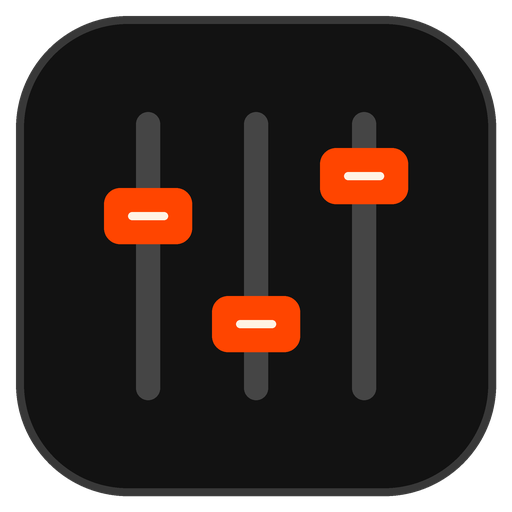
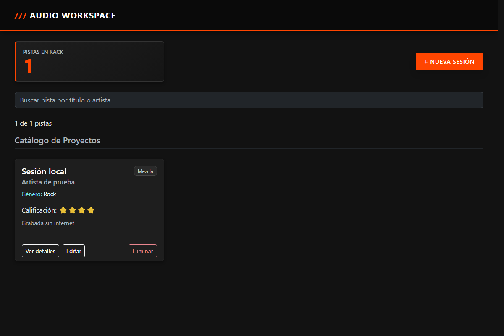

<div align="center">
  
  <h1>Gestor de Tracks</h1>
  <p><strong>Tu biblioteca de sesiones, de la composición al máster.</strong></p>
  <p>Organiza pistas, escucha tus audios y sigue el avance de cada proyecto musical desde una aplicación local.</p>
  <p><strong>Electron 41</strong> · <strong>Node.js 24+</strong> · <strong>Express 5</strong> · <strong>SQLite</strong></p>
  <p><a href="#empezar">Empezar</a> · <a href="#funciones">Funciones</a> · <a href="#estructura">Estructura</a> · <a href="docs/datos-locales.md">Datos y respaldos</a></p>
</div>



## Funciones

- **Catálogo de sesiones:** crea, consulta, edita y elimina pistas con título, artista y género.
- **Seguimiento de producción:** Composición → Grabación → Mezcla → Masterización → Finalizado.
- **Audios por pista:** adjunta, reproduce y reemplaza archivos desde la biblioteca.
- **Búsqueda rápida:** filtra por título o artista y consulta el total de pistas.
- **Valoración y notas:** calificaciones de 1 a 5 y comentarios para cada sesión.
- **Biblioteca local:** SQLite y copias de audio independientes para cada usuario y equipo.
- **Interfaz en español:** tema oscuro, acentos naranja y diálogos con navegación por teclado.

La aplicación funciona sin servicios externos durante su uso. La instalación de dependencias y la compilación pueden necesitar internet.

## Empezar

Necesitas **Node.js 24 o posterior**, npm y Git. La aplicación de escritorio y su instalador están orientados a Windows.

Clona este repositorio desde su botón **Code**, abre la carpeta descargada y ejecuta:

```bash
npm ci
npm start
```

Para abrir la aplicación en el navegador:

```bash
npm run dev
```

Visita **http://127.0.0.1:3000**. No necesitas configurar una base de datos ni crear un archivo `.env`.

> En PowerShell, si una política impide ejecutar `npm.ps1`, utiliza `npm.cmd` en los comandos anteriores.

## Comandos

| Comando | Descripción |
| --- | --- |
| `npm start` | Abrir la aplicación de escritorio con Electron |
| `npm run dev` | Iniciar el servidor local para navegador |
| `npm run test:api` | Probar validación, SQLite, audios, reinicios y aislamiento entre bibliotecas |
| `npm run test:ui` | Probar la interfaz en Electron con una API simulada y sin peticiones externas |
| `npm run build` | Generar el instalador de Windows con electron-builder |
| `npm run test:desktop` | Probar la aplicación empaquetada; requiere compilar primero |

El instalador se genera en `release-local-1.2.0/`. Los ejecutables y las dependencias no se guardan en Git.

## Estructura

```text
gestor-de-tracks/
├── .github/workflows/    # Verificación automática de la API
├── build/               # Configuración del instalador NSIS
├── docs/                # Documentación y capturas
├── models/Pista.js      # Validación y fases de producción
├── public/              # Interfaz, estilos, diálogos e iconos
├── scripts/             # Herramientas para generar los iconos
├── tests/               # Pruebas de API, interfaz y aplicación empaquetada
├── main.js              # Ventana y ciclo de vida de Electron
├── server.js            # API HTTP y archivos estáticos
├── storage.js           # Persistencia y biblioteca SQLite
└── package.json         # Dependencias, comandos y empaquetado
```

El navegador y la ventana de Electron consumen la misma API local. `server.js` coordina las solicitudes, `models/Pista.js` valida los datos y `storage.js` los guarda en SQLite. Los audios se almacenan aparte, en la carpeta de datos del usuario.

## API local

| Método | Ruta | Operación |
| --- | --- | --- |
| `GET` | `/api/pistas` | Listar pistas; acepta `?fase=Mezcla` |
| `POST` | `/api/pistas` | Crear una pista |
| `PUT` | `/api/pistas/:id` | Actualizar una pista |
| `DELETE` | `/api/pistas/:id` | Eliminar una pista y su copia de audio |

Los campos son `titulo`, `artista`, `genero`, `fase`, `calificacion` y `comentario`. Para adjuntar audio, envía `multipart/form-data` con el campo `archivoAudio`. Las operaciones sin archivo también aceptan JSON.

## Datos y documentación

En Windows, los datos se guardan en `%LOCALAPPDATA%\EstudioHiro`. Cada instalación comienza con su propia biblioteca; el repositorio no incluye canciones, bases de datos ni credenciales.

- [Datos locales, configuración y copias de seguridad](docs/datos-locales.md)
- [Guía para contribuir](CONTRIBUTING.md)
- [Identidad visual](DESIGN.md)
- [Contrato de interacción](UX-CONTRACT.md)

Las pruebas de migración histórica dependen de una biblioteca privada y no se ejecutan en un clon limpio. La comprobación automática de GitHub ejecuta las pruebas de API; las pruebas de interfaz y escritorio se ejecutan en un entorno con escritorio.
